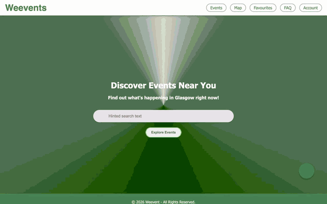
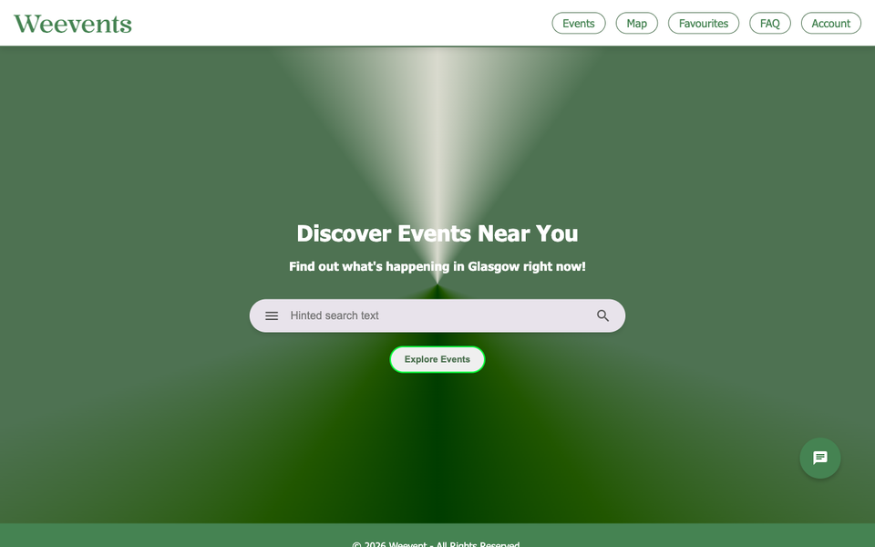
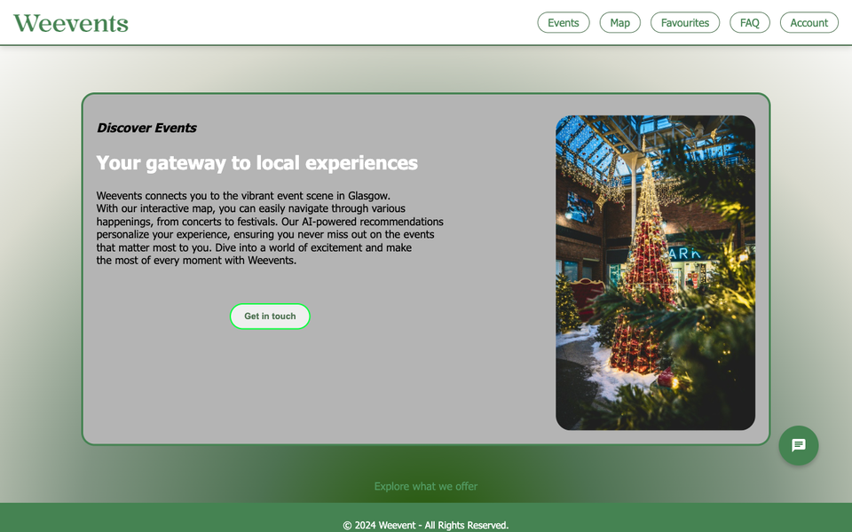
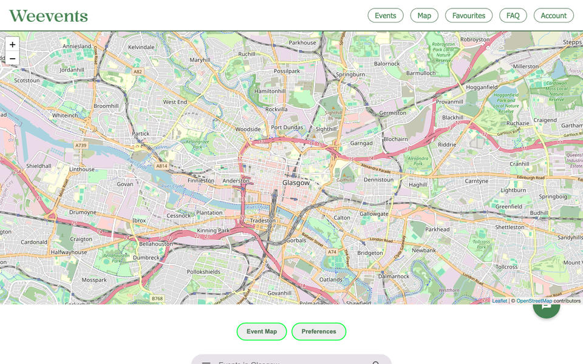
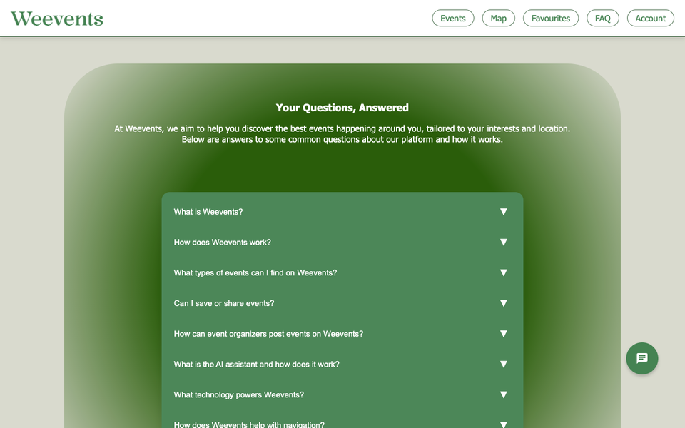

<div align="center">



# Weevent

**A front-end prototype for discovering local events in Glasgow: a search-led home page, an events page, an interactive map and an FAQ.**


[What works](#what-works-and-what-does-not) · [Run it](#run-it) · [Structure](#project-structure) · [What I learned](#what-i-learned)

</div>

Weevent is an early design of an events-discovery site. The pages, navigation and map are built. Event data, accounts, favourites and the AI assistant are not, and this README says which is which.

<div align="center">




</div>

## What works and what does not

| Page | State |
|---|---|
| Home | Search bar and *Explore Events* button, laid out but not wired to anything |
| Events | Intro text and a *Get in touch* pop-up form. Submitting shows a notice, because nothing is sent |
| Map | Real Leaflet map on OpenStreetMap tiles, centred on Glasgow, with pan and zoom. No event markers yet |
| FAQ | Nine collapsible questions, working |
| Favourites | *Favourites* and *Past Events* buttons with placeholder text, no list behind them |
| Account, Preferences, Assistant | Empty page shells with the shared header and footer |

The FAQ and the events text describe an AI assistant and event recommendations. Those are plans: there is no model call, event data or favourites list in this code.

## Run it

The frontend is plain files with no build step. Serve the **repository root**, because the pages load `../styles` and `../images`:

```bash
git clone https://github.com/Bogdusik/Weevent.git
cd Weevent
python3 -m http.server 8000
```

Then open <http://localhost:8000/frontend/index.html>. The map needs an internet connection for its tiles and for Leaflet from unpkg.

The `backend/` folder is an empty Django project with only the admin route and an SQLite file. To start it, set a secret key first:

```bash
cd backend/weevents_backend
SECRET_KEY=change-me python3 manage.py runserver
```

## Project structure

```
Weevent/
├── frontend/             # The pages: index, events, map, faq, favourites, account, preferences, llama
├── styles/style.css      # Shared styles, including the phone breakpoints
├── scripts/              # faq.js (accordion); the other scripts are empty stubs or unused
├── images/               # Photos used on the events page
├── backend/              # Django project skeleton, no models or API yet
├── Weevents_final_v1.0/  # Older snapshot of the same prototype
└── Weevent-main 2/       # Another older snapshot
```

The two snapshot folders are earlier copies of the site kept from the project's history. The root `frontend/`, `styles/` and `scripts/` are the current version.

## Limits

- Everything on the pages is static text. There is no event data, search, login or saved state.
- The map and the Material Icons font load from public CDNs.
- The backend has no models, endpoints or connection to the frontend.

## What I learned

- **Prototype honesty:** the old README listed following, liking, event adverts and a MySQL schema, none of which exist in the code. Writing down what each page really does was more useful than the feature list.
- **Viewport meta matters:** only some pages had it. Those pages rendered at true phone width and exposed a header that did not fit, while the others were silently shrunk.
- **Leaflet basics:** a tile layer, a centre and a zoom level give a working map in a dozen lines.
